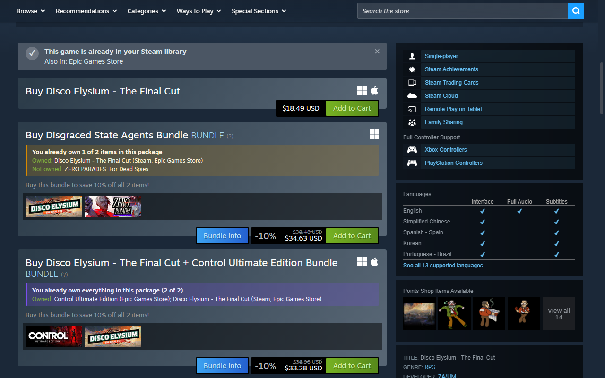

# Owned Elsewhere — library checker for Steam

[](https://microsoftedge.microsoft.com/addons/detail/cofnfdoinmhiallggicbamajnemcljgi)



[Русская версия](README.ru.md)

A browser extension that marks games on the Steam store that you already own in **other** libraries —
Epic Games Store, GOG, Xbox / Microsoft Store, Ubisoft Connect, EA app, Amazon Games, Battle.net, itch.io and more —
so you don't buy the same game twice.

## What it shows

- **Game page:** one banner above the purchase options — "You already own this game: Epic Games Store".
- **Bundles and multi-game packages:** how much you already own — "You already own 1 of 2 items in this package", with the names.
  Subscriptions (e.g. GTA+) and in-game currency are never marked.
- **DLC pages:** whether you own the base game.
- **Search, wishlist, cart, store lists:** a badge under the title and a highlighted row.
- **Three levels:** *owned* (violet) — bought in another store; *maybe* (dashed) — Xbox libraries that mix in Game Pass titles,
  console versions, or only another edition matches (e.g. GTA V vs GTA V Legacy); *already in Steam* (grey).
  Each store's level can be changed, and any game can be excluded with × on its banner.
- **Xbox:** PC and console releases are told apart; “Check Xbox games” lets you confirm each one (also as a spreadsheet).
- **macOS / Linux:** Windows-only releases in other stores are shown as “maybe owned”.
- **Hide in Steam:** one click uses Steam's own Ignore with the reason “I own it on another store”.
- **Profile game lists** (yours and friends') on steamcommunity.com — optional, asks for access when turned on.

Games are matched by **Steam App ID** when the source provides it (GOG Galaxy does for most games, from every
connected store), otherwise by normalised title. Title matches are labelled as such.

## Supported sources

| Source | File | Matching |
| --- | --- | --- |
| GOG Galaxy 2.0 | `C:\ProgramData\GOG.com\Galaxy\storage\galaxy-2.0.db` (close Galaxy first) | Steam ID for ~90% of games |
| Playnite | CSV from the Library Exporter Advanced add-on (Name, Sources, Platforms), any Playnite language | title; Steam ID for Steam games |
| GOG Galaxy Export Script | `gameDB.csv` | title |
| Heroic Games Launcher | `store_cache/legendary_library.json`, `gog_library.json`, `nile_library.json` | title |
| Any CSV / TSV | column picker if headers are not recognised; optional Steam App ID column | title or Steam ID |
| Plain list | paste or `.txt`, one title per line, optional `| store` | title |
| Backup | `.json` exported by the extension | — |

Several sources can be loaded at once; each re-import replaces only that source.

## Privacy

Everything stays in the browser (`chrome.storage.local`). The extension makes no network requests of its own,
except reading the public Steam package contents API (`store.steampowered.com/api/packagedetails`) from Steam
store pages to find out which games a package includes. See [PRIVACY.md](PRIVACY.md).

## Install from source

1. `chrome://extensions` (or `edge://extensions`) → enable Developer mode → **Load unpacked** → choose the `extension` folder.
2. Firefox: `about:debugging` → This Firefox → Load Temporary Add-on → `dist/firefox/manifest.json` (run `npm run build` first).

## Development

```bash
npm install          # sql.js and papaparse (vendored into extension/lib)
npm test             # unit tests for importers and matching
npm run e2e -- galaxy-2.0.db,playnite.csv   # headless Edge: imports via the options page, checks game pages, search, cart
npm run build        # dist/*-chrome.zip, dist/*-firefox.zip, dist/*-source.zip
```

UI strings live in `tools/locales.js` (English and Russian); `npm run locales` regenerates `extension/_locales`.

Third-party code in `extension/lib` is unmodified: [sql.js](https://github.com/sql-js/sql.js) 1.12.0 (`dist/sql-wasm.js`,
`dist/sql-wasm.wasm`, MIT) and [Papa Parse](https://github.com/mholt/PapaParse) 5.5.3 (`papaparse.min.js`, MIT).

## License

MIT © 2026 Kreata Media — see [LICENSE](LICENSE). Not affiliated with Valve, GOG, Epic Games or any other store.
